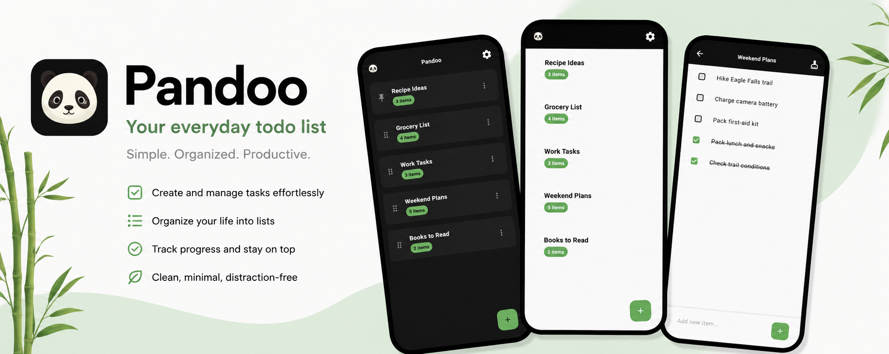
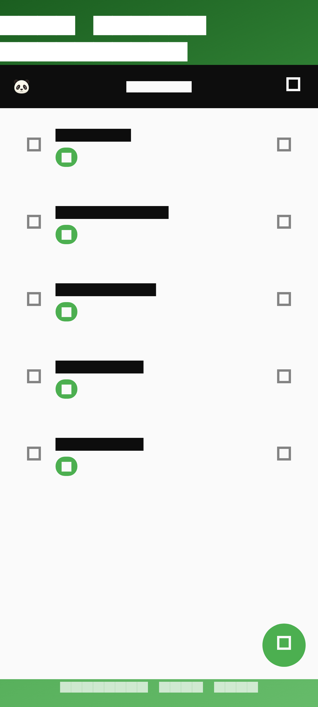
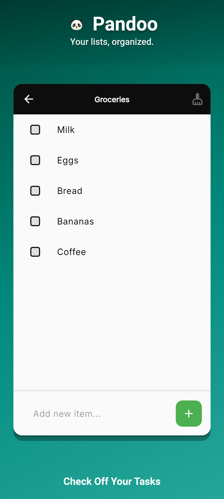
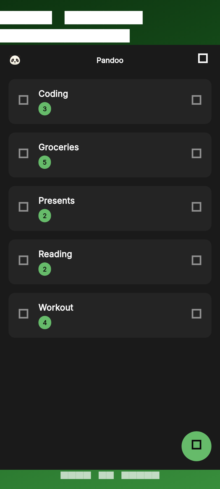
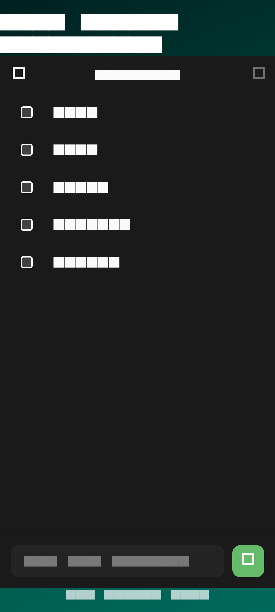

<picture>
  <source media="(prefers-color-scheme: dark)" srcset="assets/images/github/banner.png">
  
</picture>

<p align="center">
  <a href="LICENSE"></a>
  
  
  
</p>

<p align="center">
  <a href="https://play.google.com/store/apps/details?id=com.teamsuperpanda.pandoo"></a>
  <a href="https://apps.apple.com/us/app/pandoo/id1559676245"></a>
</p>

Your friendly, local-first todo list. Fast. Minimal. Private. No clouds, no accounts - just you and your tasks.

Built by [Team Super Panda](https://www.teamsuperpanda.com).

---

## Screenshots

| Home | List detail |
|---|---|
|  |  |
|  |  |

These are the store screenshots generated by the golden tests.

## What it does

Pandoo is a no-nonsense todo app that keeps your data on your device.

- **Multiple lists** - create, rename and delete lists.
- **Pin lists** - keep important lists at the top.
- **Reorder lists** - drag unpinned lists into the order you want.
- **Todo items** - add items, check them off, swipe to delete.
- **Search within a list** - filter items as you type.
- **Clean completed** - remove every completed item in one action.
- **Light and dark themes** - follow the system or pin a theme.
- **75 locales** - bundled ARB translations, choice of language in settings.
- **Optional FAB animation** - turn the floating button animation off.

The app has no network permission, no accounts and no telemetry. Nothing you
type leaves the device.

---

## Tech

| Layer | Choice |
|---|---|
| UI | Flutter with Hive reactive listeners |
| Storage | Hive (local, no server) |
| L10n | ARB + `flutter gen-l10n` |
| Fonts | Inter (bundled, no network calls) |
| Tests | `flutter_test`, golden screenshots |

No backend. No sync. No app data leaves your device.

---

## Run it

Requirements: Flutter 3.9 or newer with Dart 3.9.

```bash
git clone https://github.com/teamsuperpanda/pandoo.git
cd pandoo
flutter pub get
flutter gen-l10n
flutter run
```

Hive adapters (`*.g.dart`) and the localization output are committed, so no
code-generation step is needed for a normal build. If you change a Hive model,
regenerate its adapter with `build_runner` (see CONTRIBUTING).

### Tests

```bash
flutter test --coverage
```

Goldens are part of the suite. Update them with
`flutter test --update-goldens` when a UI change is intentional, and commit the
new images.

---

## Contributing

Read [CONTRIBUTING.md](CONTRIBUTING.md), then look for
[good first issues](https://github.com/teamsuperpanda/pandoo/labels/good%20first%20issue).
The roadmap lives in [ROADMAP.md](ROADMAP.md). Security reports go through
[SECURITY.md](SECURITY.md), never a public issue.

---

## License

The code is [MIT licensed](LICENSE), copyright 2021-2026 Team Super Panda.
Bundled artwork is CC BY 4.0 (see [ASSETS-LICENSE.md](ASSETS-LICENSE.md)).
Third-party components and their licenses are listed in
[THIRD_PARTY.md](THIRD_PARTY.md). The Pandoo name and panda mark are covered by
the [trademark and brand policy](TRADEMARKS.md).
